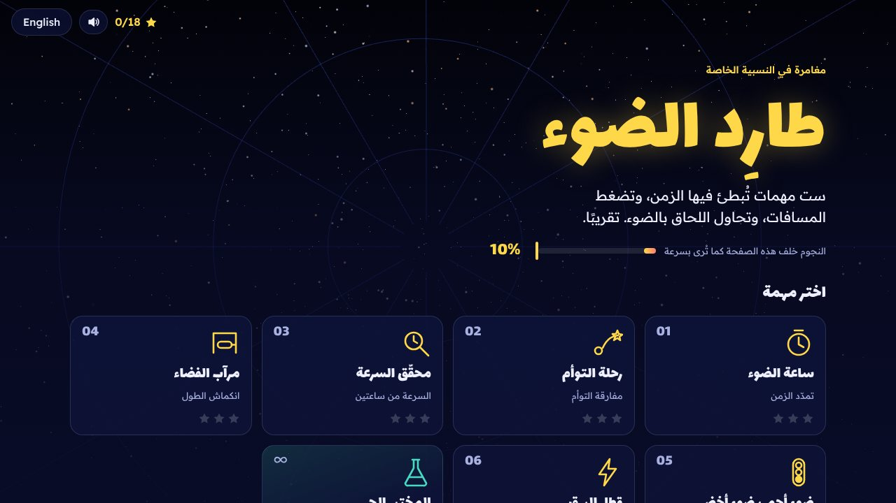
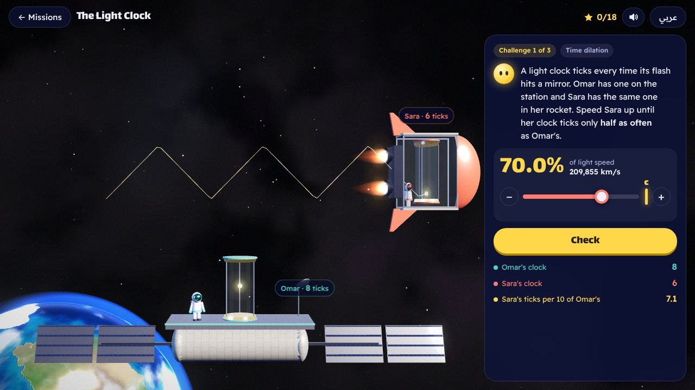
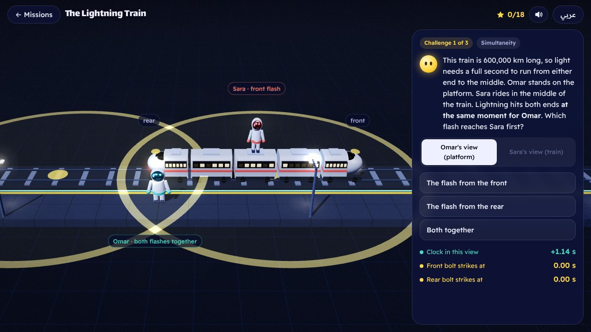
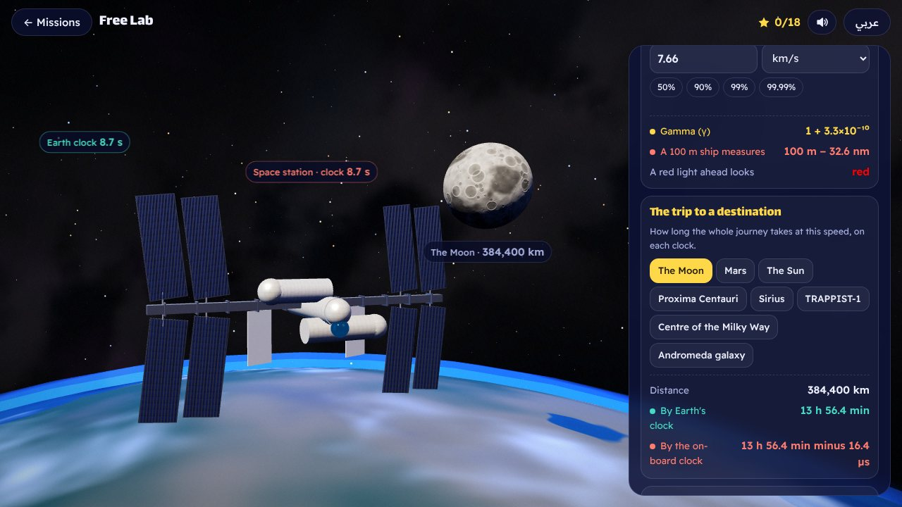
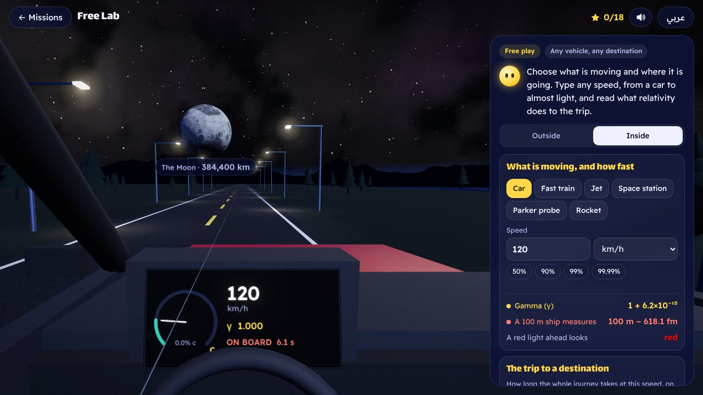

# Chase the Light · طارِد الضوء

A 3D game that teaches special relativity to kids and adults. Six short missions and a free lab let you slow time, squeeze space and try to catch up with light. It runs in the browser, in Arabic and English, with no installation.



**Play it:** [salahalshafey.github.io/chase-the-light](https://salahalshafey.github.io/chase-the-light/)

## What you do in it

Before each mission you can watch a short lesson: three animated slides that show the idea the mission is built on, some with a speed slider to try it out. Each mission then has three challenges and ends with a short explanation for children, plus a "for curious minds" note with the formula. Collect all 18 stars and the game throws you a party.

| # | Mission | What it teaches | What you do |
|---|---------|-----------------|-------------|
| 1 | The Light Clock | Time dilation | Speed up Sara's rocket until her light clock ticks half as often as Omar's. |
| 2 | The Twin Trip | The twin paradox | Fly to Proxima Centauri, Sirius and TRAPPIST-1 while the twin at home ages faster. |
| 3 | Speed Detective | Speed from two clocks | Work out a mystery ship's speed from its clock alone. |
| 4 | The Space Garage | Length contraction | Fly a 100 m ship fast enough to fit in an 80, 50, then 20 m garage. |
| 5 | Red Light, Green Light | Doppler shift and aberration | From the cockpit, fly fast enough that a red light looks green. |
| 6 | The Lightning Train | Simultaneity | Watch Einstein's train from the platform, then from the train. |




### The Free Lab

Choose what is moving (car, fast train, jet, space station, Parker Solar Probe or rocket) and where it is going (the Moon, Mars, the Sun, Proxima Centauri, Sirius, TRAPPIST-1, the centre of the Milky Way or the Andromeda galaxy). Type any speed in m/s, km/s, km/h or percent of light speed.

The scenery rebuilds itself around the vehicle: a night road, a railway, a cloud deck, the Earth from orbit, or deep space. You can watch from outside or sit inside each vehicle, where the dashboard shows the on-board clock next to Earth's clock. Three cards give the answers:

- **What is moving, and how fast:** gamma, the length of a 100 m ship, and the colour of a red light ahead.
- **The trip to a destination:** how long the journey takes by Earth's clock and by the on-board clock.
- **Two clocks side by side:** how far the on-board clock falls behind after any amount of Earth time.




## Controls

- Drag the speed slider, or use the − and + buttons for fine steps. It stops just short of light speed.
- In the cockpit mission and the lab's inside view, drag the picture to look around.
- The top bar has the language switch (Arabic is the default), the sound button, and the star count. Stars and the chosen language are saved in the browser.
- The game opens on a short loading screen with a **Start** button. Browsers do not let a page play sound until you tap something, so the music begins when you press it.
- Each mission opens behind a loading curtain with a "did you know?" fact, so the scene is ready before you see it. When it is ready, choose **See the lesson** or **Enter the mission**. In the lesson, use Back and Next (or the arrow keys); you can enter the mission from any slide.
- While the curtain or the end-of-mission summary is open, the scene behind it is paused: clocks stop ticking and the engine goes quiet.

## Run it on your own computer

Open `index.html` in a recent browser. That is enough.

If you prefer a local server:

```bash
python3 -m http.server 8000 # python -m http.server 8000
# then open http://localhost:8000
```

## Project structure

```
index.html            the page: top bar, menu, side console, summary dialog
css/style.css         all styling (one visual theme, right-to-left aware)
js/
  strings.js          every piece of text, as [English, Arabic]
  core.js             the relativity formulas, language, number formatting
  kit.js              graphics kit: textures, sky, planets, rockets, lights, bloom
  audio.js            all sound, synthesised with the Web Audio API
  missions/
    light-clock.js    missions 1 and 3
    twin-trip.js      mission 2
    garage.js         mission 4
    cockpit.js        mission 5, and the star field that relativity bends
    train.js          mission 6
  lab/
    vehicles.js       the six things that move
    destinations.js   the eight places to go
    interiors.js      the view from inside each vehicle
    journey.js        the lab's 3D scene and its two cameras
    lab.js            the lab's control panel and results
  lessons.js          the illustrated lesson before each mission (2D canvas animations)
  celebrate.js        confetti and fireworks for collecting all 18 stars
  app.js              menu, mission flow, labels, saving, render loop (loaded last)
vendor/three/         Three.js r128 and its bloom add-ons (MIT licence)
tests/physics.test.js checks the formulas against the textbook
docs/                 screenshots used in this README
LICENSE               MIT licence for the game's code
```

The scripts are ordinary `<script>` files loaded in order from `index.html`; each one uses the files above it. There are no modules and no bundler, which is why the game also works when opened straight from disk.

## The physics

With β = v/c and γ = 1/√(1 − β²):

| Effect | Formula |
|--------|---------|
| Time dilation | t_onboard = t_earth × √(1 − β²) |
| Speed from two clocks | v = c × √(1 − (t_onboard / t_earth)²) |
| A trip | t_earth = distance / v, then t_onboard as above |
| Length contraction | L = L₀ × √(1 − β²) |
| Doppler shift, straight ahead | λ_seen = λ × √((1 − β) / (1 + β)) |
| Aberration | cos θ′ = (cos θ + β) / (1 + β cos θ) |
| Simultaneity | Δt′ = v × L₀ / c² |

These live in `js/core.js`. At everyday speeds 1 − √(1 − β²) is far smaller than ordinary floating-point rounding, so the game computes it as β² / (1 + √(1 − β²)), which stays accurate down to a walking pace. A year is 365.25 days.

Scenery speed on screen is compressed (a logarithmic scale) so that a car and a rocket are both watchable. Every number shown is computed from the true speed.

## Changing things

- **Text or translation:** edit `js/strings.js`. Each entry is `key: ['English', 'Arabic']`.
- **A lesson slide:** the words are `l_<mission>_<n>h` (heading) and `l_<mission>_<n>` in `js/strings.js`; the drawing is the matching entry in `SLIDES` in `js/lessons.js`.
- **A new destination:** add an entry to `DESTS` in `js/lab/destinations.js` with its distance in light-seconds and a function that builds its model, then add its name to `js/strings.js`.
- **A new vehicle:** add a model and an entry in `VEHICLES` in `js/lab/vehicles.js`, and an interior in `js/lab/interiors.js`.
- **Sounds:** each effect is one line in `js/audio.js`.

## Tests

```bash
node tests/physics.test.js
```

This checks the formulas in `js/core.js` against independent calculations. It needs only Node.js.

## Browser support and performance

The game needs WebGL, which every current desktop and mobile browser has. Everything you see and hear is generated in code, so there are no images or audio files to download. If the frame rate drops, the game lowers its own quality in two steps: first the resolution, then the glow effect.

## Credits

- 3D rendering by [Three.js](https://threejs.org/) r128, included in `vendor/three/` under the MIT licence.
- Fonts: Lalezar and Readex Pro, loaded from Google Fonts.

## Licence

The game's code is released under the [MIT licence](LICENSE): anyone may use, copy and change it, as long as the copyright notice stays with it. Three.js in `vendor/three/` keeps its own MIT licence.

---

<div dir="rtl">

## بالعربية

**طارِد الضوء** لعبة ثلاثية الأبعاد تشرح النسبية الخاصة للأطفال والكبار. تعمل في المتصفح مباشرة، بالعربية والإنجليزية، ودون أي تثبيت.

فيها ست مهمات قصيرة، في كل مهمة ثلاثة تحديات وشرح مبسّط في نهايتها:

1. **ساعة الضوء:** تمدّد الزمن.
2. **رحلة التوأم:** مفارقة التوأم.
3. **محقّق السرعة:** حساب السرعة من ساعتين.
4. **مرآب الفضاء:** انكماش الطول.
5. **ضوء أحمر، ضوء أخضر:** انزياح دوبلر وزيغ الضوء.
6. **قطار البرق:** نسبية التزامن.

وقبل كل مهمة يمكنك مشاهدة درس قصير من ثلاث شرائح متحركة يشرح الفكرة العلمية للمهمة، ثم الدخول إليها. وحين تجمع النجوم الـ 18 كلها تحتفل معك اللعبة.

وفي **المختبر الحر** تختار ما الذي يتحرك (سيارة، قطار سريع، طائرة، محطة الفضاء، مسبار باركر، صاروخ) وإلى أين يتجه (من القمر إلى مجرّة أندروميدا)، وتكتب أي سرعة، ثم ترى من الخارج أو من داخل المركبة ما تفعله النسبية بالزمن والطول واللون.


</div>
